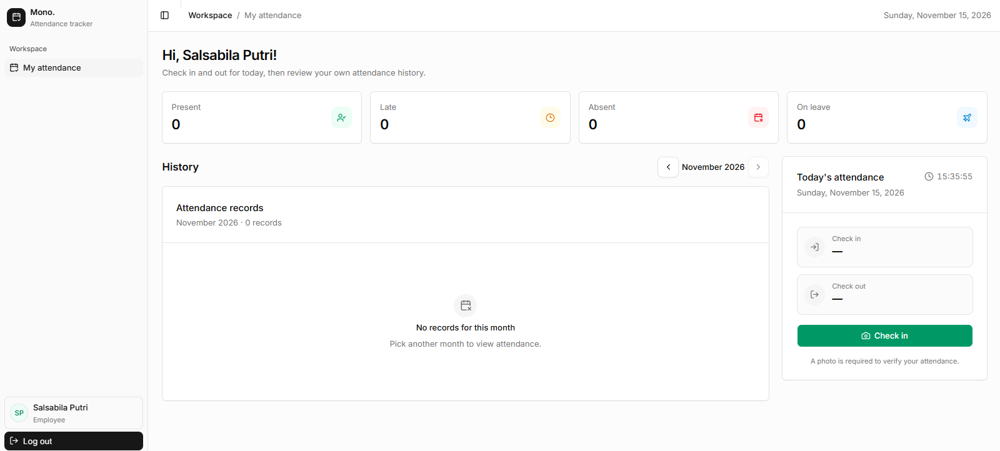
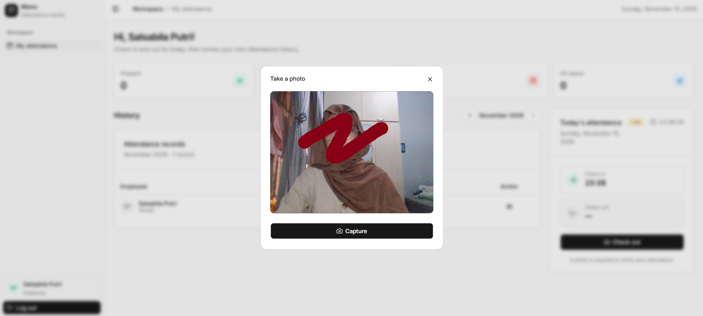
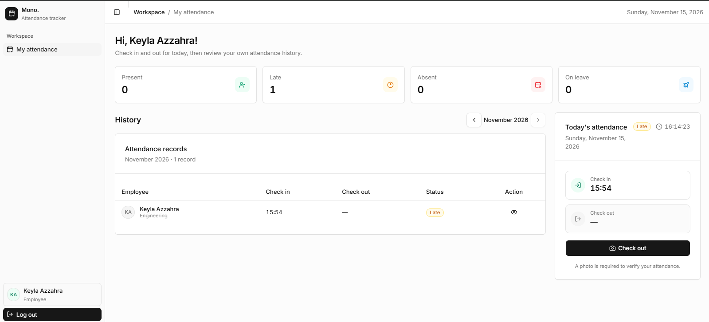
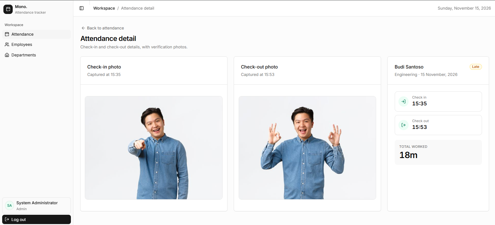
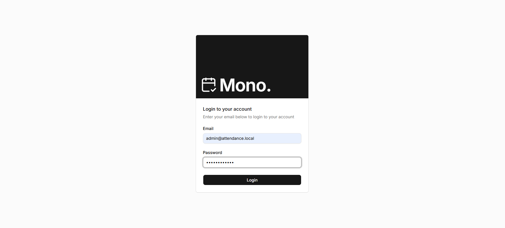
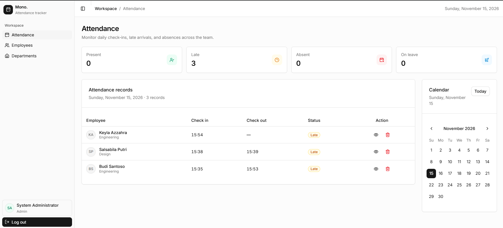
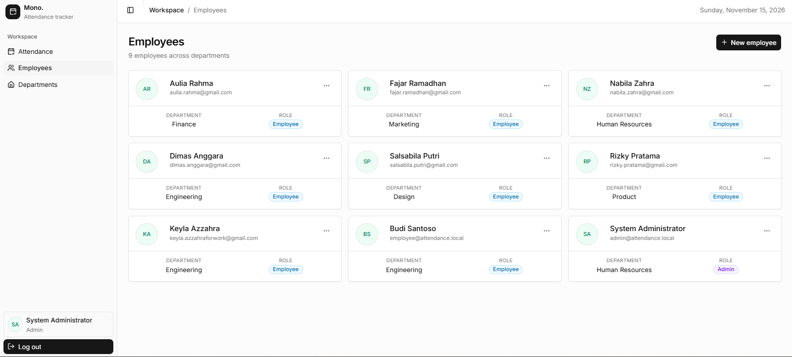
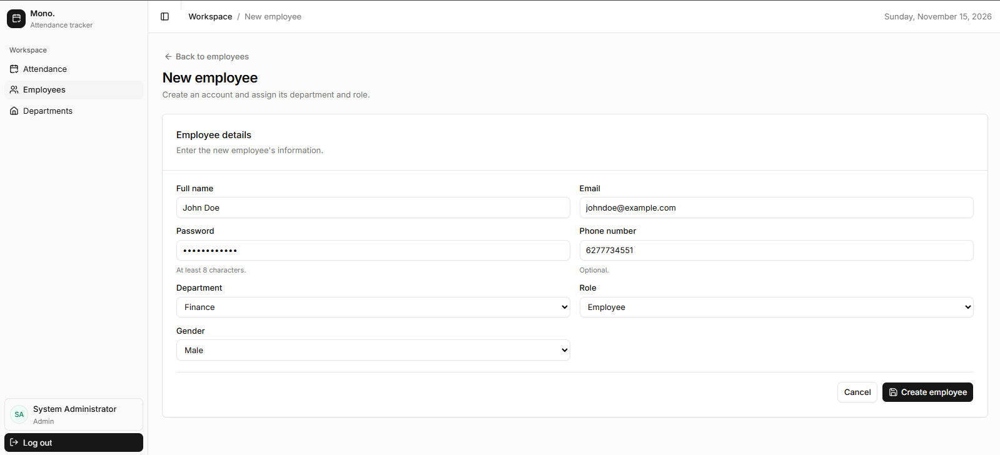

# mono-attendance
Simple web-application for attendance

# expected outcome
- Web applicated where employees can check-in and check-out from home (WFH)
- Web application for admin where they can see employee records

# result

<table>
  <tr>
    <td></td>
    <td></td>
  </tr>
  <tr>
    <td></td>
    <td></td>
  </tr>
  <tr>
    <td></td>
    <td></td>
  </tr>
  <tr>
    <td></td>
    <td></td>
  </tr>
</table>

# setup
Install dependencies once (pnpm is the repo's package manager; `npm run` also
works, with a devEngines warning):

```bash
pnpm install
```

# scripts

All scripts live in the root `package.json` and can be run with `npm run <script>`
or `pnpm run <script>`.

| Script | Command | What it does |
| --- | --- | --- |
| dev | `npm run dev` | Start Docker Postgres+Redis, then backend (watch, `:3000`) + frontend (Vite, `:5173`) |
| start:dev | `npm run start:dev` | NestJS in watch mode on `:3000` (deps must already be running) |
| dev:backend | `npm run dev:backend` | Starts Docker Postgres+Redis, then NestJS watch mode |
| dev:frontend | `npm run dev:frontend` | Vite dev server on `:5173` |
| seed | `npm run seed` | Start Docker Postgres+Redis, build the backend and seed it via `backend/.env` |
| build:backend | `npm run build:backend` | Compile NestJS to `backend/dist` |
| build:frontend | `npm run build:frontend` | Build the React app to `frontend/dist` |
| lint | `npm run lint` | Lint backend and frontend |
| docker:deps | `npm run docker:deps` | Start only Postgres and Redis (used by local dev) |
| docker:dev | `npm run docker:dev` | Build images and run the full stack in the foreground |
| docker:up | `npm run docker:up` | Build images and run the full stack in the background |
| docker:ps | `npm run docker:ps` | Show container status and health |
| docker:logs | `npm run docker:logs` | Follow logs from all containers |
| docker:seed | `npm run docker:seed` | Run the seeder inside the running backend container |
| docker:down | `npm run docker:down` | Stop the stack (volumes are kept) |
| docker:reset | `npm run docker:reset` | Stop the stack and delete all volumes |

# local development
`npm run dev` is the one-command flow: it starts Postgres and Redis in Docker,
then runs the backend and frontend on the host with watch mode.

```bash
npm run dev      # http://localhost:5173 and http://localhost:3000
npm run seed     # optional: (re)create seed departments + users
```

For this hybrid mode, `backend/.env` points at the Docker services through
ports published on `127.0.0.1` only:

- PostgreSQL: `localhost:5433` (user `postgres`)
- Redis: `localhost:6379`

This leaves a PostgreSQL installation already running on the standard `5432`
untouched. To use your own database instead, update `backend/.env` and run
`npm run start:dev` + `npm run dev:frontend` without `docker:deps`.


# run with docker
Requires Docker Desktop (or Docker Engine + Compose v2).

```bash
npm run docker:dev     # foreground, rebuilds images
# or
npm run docker:up      # background
npm run docker:seed    # create the seed departments + users
```

| Service  | URL                     | Notes                                    |
| -------- | ----------------------- | ---------------------------------------- |
| frontend | http://localhost:5173   | React build served by nginx              |
| backend  | http://localhost:3000   | NestJS API                               |
| pgAdmin  | http://localhost:5050   | `admin@example.com` / `admin` by default |

After seeding, these accounts are available:

| Email                    | Password       | Role     |
| ------------------------ | -------------- | -------- |
| `admin@attendance.local` | `Password123!` | ADMIN    |
| `employee@attendance.local` | `Password123!` | EMPLOYEE |

Requests to `/auth/login` also require the API key header
`x-api-key: <API_KEY>` (defaults to `dev-api-key-change-me`).

PostgreSQL and Redis are published on `127.0.0.1` (`5433` and `6379`) so the
host-run backend can reach them; containers themselves use the internal
`5432`/`6379`. The frontend nginx proxies `/api/*` to the backend (the `/api`
prefix is stripped), so calls like `/api/auth/login` reach
`http://backend:3000/auth/login`.

Optional configuration: copy `.env.example` to `.env` and override the
defaults (database credentials, `API_KEY`, `JWT_SECRET`, published ports).
`backend/.env` is not used inside Docker; the Compose environment variables
take its place.
